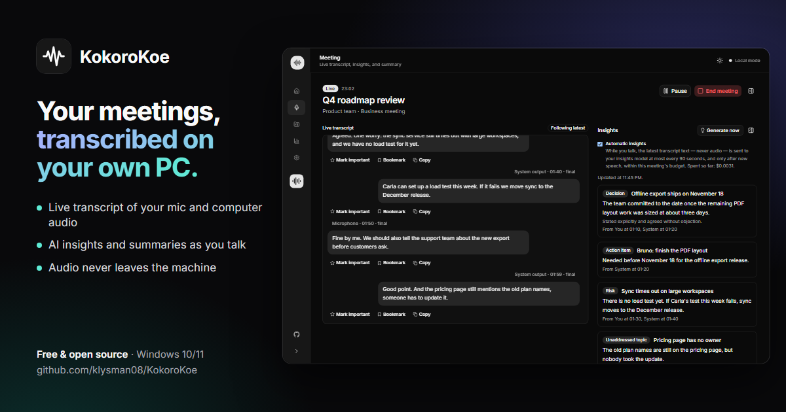
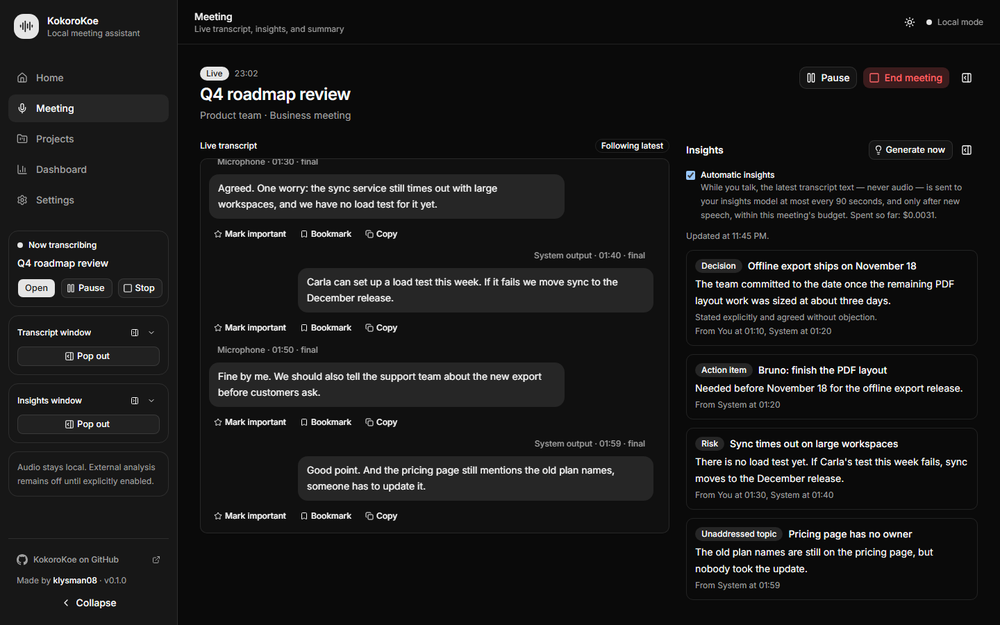
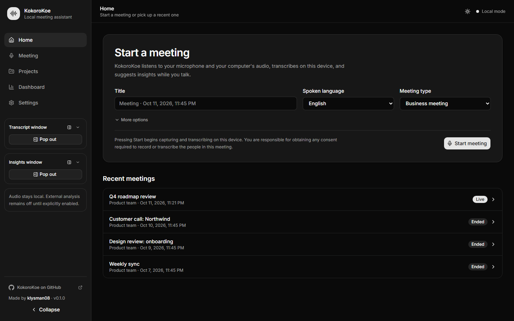
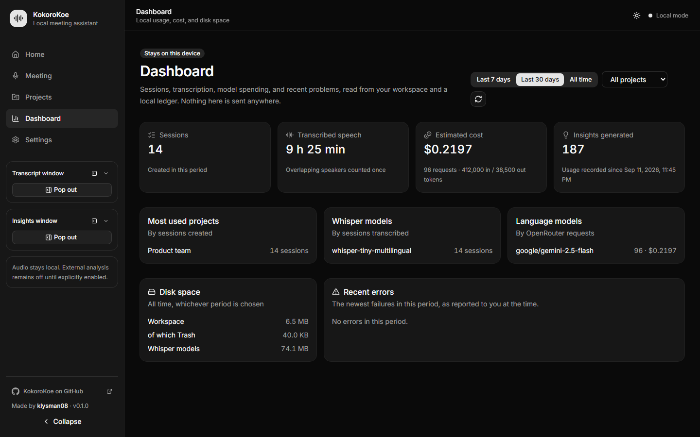

<p align="center">
  
</p>

<h1 align="center">KokoroKoe</h1>

<p align="center">
  <strong>Private meeting transcription and AI insights for Windows.</strong><br />
  Your microphone and your computer's audio, transcribed live on your own machine.
</p>

<p align="center">
  <a href="LICENSE"></a>
  
  
</p>

---

KokoroKoe is a desktop meeting assistant that listens to **both sides of a call**: what you say into
your microphone and what the others say through your speakers. It transcribes everything **on your
PC** with Whisper, so the audio never leaves the machine. If you want, it also reads the transcript
with an AI model of your choice and points out decisions, action items, and risks while you talk,
then writes a summary when the meeting ends.

Everything is saved as plain Markdown files in a folder you choose. No account, no cloud, no
subscription.

## Features

- **One press to start.** Pick a language and a meeting type, press **Start meeting**, and the
  live transcript appears. Your last choices are remembered.
- **Both sides of the conversation.** The microphone and the computer's audio are captured as
  separate channels, so the transcript shows who said what: _you_ or _the others_.
- **Local transcription.** Whisper runs on your GPU through Vulkan, or on the CPU when there is no
  GPU. Choose between Tiny, Base, and Large-v3 Turbo, downloaded and verified in the app.
- **Live insights.** Decisions, action items, risks, follow-up questions, and topics nobody has
  covered appear as cards during the meeting, each linked to the moment it came from.
- **Summary at the end.** An executive summary with topics, decisions, action items with owners
  and deadlines, risks, open questions, and next steps, saved beside the transcript.
- **Ask about any moment.** Select a line of the transcript and ask a question, or use one of the
  shortcuts: **Explain**, **Suggest a response**, **Summarize**.
- **Floating windows.** Pop the transcript or the insights out into small windows that stay on top
  of your call. Opacity, size, and a show/hide shortcut are set per window.
- **Meeting types.** Nine built-in presets (sales call, interview, brainstorm, lecture, customer
  support, and more) tell the assistant what to look for. You can write your own.
- **Files you own.** Each meeting is a folder of Markdown files: its details, transcript, and summary.
  Bookmark, mark as important, and correct lines; every correction keeps its history.
- **Local dashboard.** Time transcribed, meetings, tokens, cost, and disk space, computed on your
  PC and never sent anywhere.

## Screenshots

<p align="center">
  
</p>

<table>
  <tr>
    <td></td>
    <td></td>
  </tr>
</table>

<sub>The screenshots use fictional demo data.</sub>

## Privacy

| Stays on your PC                                        | Leaves your PC, only if you turn it on                                                             |
| ------------------------------------------------------- | -------------------------------------------------------------------------------------------------- |
| All audio, always                                       | Transcript text sent to [OpenRouter](https://openrouter.ai) for insights, summaries, and questions |
| Transcripts, summaries, and notes (Markdown)            |                                                                                                    |
| Your OpenRouter key, kept in Windows Credential Manager |                                                                                                    |
| Usage and cost history                                  |                                                                                                    |

- **Audio is never uploaded.** There is no setting that sends it anywhere.
- **AI features are off until you add a key.** Without one, KokoroKoe is a fully offline
  transcriber.
- **Privacy-respecting models by default.** Providers that keep or train on your data are
  filtered out unless you change that, and each meeting has a spending limit you set.
- **You are responsible for consent.** Tell the people in the meeting that it is being transcribed,
  as the law where you live may require.

The details are in [Privacy and limitations](docs/privacy-and-limitations.md).

## Getting started

1. Download the latest installer from the
   [Releases page](https://github.com/klysman08/KokoroKoe/releases) and run it.
   The app is not code-signed yet, so Windows SmartScreen may warn you: choose **More info → Run
   anyway**.
2. Open **Settings** and choose a folder for your meetings.
3. Download a transcription model. **Base** is a good start; **Large-v3 Turbo** is the most
   accurate and works best with a GPU.
4. _(Optional)_ Add an [OpenRouter API key](https://openrouter.ai/keys) and choose the models for
   insights and summaries.
5. Go to **Home** and press **Start meeting**.

### Requirements

- Windows 10 22H2 or Windows 11, 64-bit
- Microsoft Edge WebView2 Runtime (already installed on most PCs)
- 80 MB to 600 MB of disk space per transcription model
- Optional: a GPU with Vulkan support for faster transcription

## Build from source

Prerequisites: Node.js 24, pnpm 10, Rust 1.88+ with the `x86_64-pc-windows-msvc` target, the
Microsoft Visual C++ Build Tools, and the Windows SDK.

```powershell
pnpm install --frozen-lockfile
pnpm tauri dev
```

Checks and a release build:

```powershell
pnpm verify:frontend
pnpm verify:rust
pnpm tauri build --ci --no-bundle --target x86_64-pc-windows-msvc -- --locked
```

The native Whisper runtimes are built separately (see [Development and CI](docs/development-and-ci.md)).
To build the installers with them inside:

```powershell
pnpm release:stage   # copies and verifies the Whisper and Visual C++ runtimes into src-tauri/runtime
pnpm notices         # regenerates THIRD_PARTY_NOTICES.md
pnpm release:build   # MSI and NSIS installers in src-tauri/target/.../bundle
```

`pnpm screenshots` regenerates the images in this README from the real interface with demo data.

## Project status

This is the first public version. It has been tested on Windows 11 with an NVIDIA GPU. Windows 10,
AMD and Intel GPUs, and CPU-only computers have not been verified yet, and transcription accuracy
varies with the model, the language, and the audio. A rolling summary during the meeting and
sharing presets between projects are planned.

Found a bug or have an idea? [Open an issue](https://github.com/klysman08/KokoroKoe/issues).

## Documentation

- [Architecture](docs/architecture.md) and the [decision records](docs/adr)
- [Privacy and limitations](docs/privacy-and-limitations.md)
- [Development and CI](docs/development-and-ci.md)
- [Dependencies and licenses](docs/dependency-licenses.md)

## License

[MIT](LICENSE) © 2026 [klysman08](https://github.com/klysman08)

KokoroKoe uses [whisper.cpp](https://github.com/ggml-org/whisper.cpp) and OpenAI's Whisper models
(MIT), [Tauri](https://tauri.app), and [React](https://react.dev).
